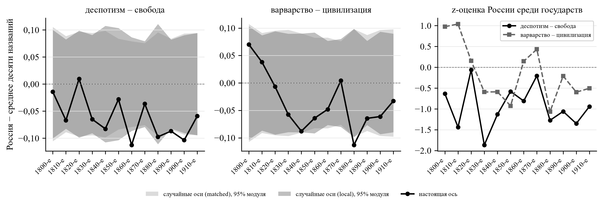

# Дополнительные проверки устойчивости результатов

Материалы к исследованию «Образ России в британской прессе 1800–1919 гг.: опыт векторного семантического анализа». Самостоятельная документация репозитория, не приложение к статье. Основные показатели — разность между проекцией *russia* и средней проекцией десяти других названий в каждой модели, а также ранг среди одиннадцати названий (1 — минимальная проекция).

## 1. Чувствительность к составу осей и сравнительной группы

При последовательном исключении каждой опорной пары знак разности меняется только в моделях 1820-х годов по обеим осям и 1870-х по оси цивилизации. Диапазоны при исключении пар показывают чувствительность к выбору опорной лексики, а не доверительные интервалы.

При исключении отдельных названий и сочетаний из сравнительной группы отрицательные разности устойчиво сохраняются по оси свободы в 1810-е и 1830–1910-е годы, по оси цивилизации — в 1830–1860-е и 1880–1900-е годы. В 1910-е годы по оси цивилизации исключение *england* и *britain* уменьшает отрицательную разность до −0,000631. Сокращение отставания в 1870-е относительно 1860-х сохраняется при исключении Турции, Германии и Пруссии либо Англии и Британии (три отдельных сценария). При исключении Германии и Пруссии разности по оси цивилизации в 1900-е и 1910-е годы составляют −0,057 и −0,053.

Данные: [исключение пар](../results/tables/05_leave_one_pair_summary.csv), [исключение названий](../results/tables/05_country_group_sensitivity.csv), [альтернативные способы построения осей](../results/tables/05_axis_construction_sensitivity.csv), [параллельность опорных пар](../results/tables/05_working_pair_parallelism.csv).

## 2. Сравнение со случайными осями

Ноутбук [03_null_tests.ipynb](../03_null_tests.ipynb) сравнивает наблюдаемые отклонения с результатами на случайных осях, построенных тем же способом из 20 слов. Для каждого варианта и каждой оси формируется 4000 наборов, одинаковых по составу во всех двенадцати моделях. Вариант *matched* использует слова общего словаря сопоставимой средней относительной частоты, *local* ограничивает подбор семантическим окружением опорной лексики, *shuffle* перемешивает исходные двадцать опорных слов, изменяя пары и ориентацию. Для пула слов применены минимальная частота 50 в каждой модели и словарный фильтр; параметры и seed указаны в ноутбуке.

Слева и в центре: разности проекций на рабочих осях и границы, которые модуль разности на случайных осях превышает в 5% случаев (*matched*, *local*). Справа: стандартизованное положение России среди 59–69 названий государств и территорий внутри соответствующей модели. Полосы не являются доверительными интервалами.

| Проверка | Наблюдается | matched | local | shuffle |
| --- | ---: | ---: | ---: | ---: |
| Свобода, средняя разность 1830–1910-х | −0,075 | 0,011 | 0,024 | 0,038 |
| Цивилизация, средняя разность 1830–1910-х | −0,058 | 0,038 | 0,045 | 0,057 |
| Цивилизация, среднее 1800–1810-х минус среднее 1830–1860-х | +0,119 | 0,006 | 0,004 | 0,072 |
| Свобода, тот же контраст | +0,031 | 0,462 | 0,490 | 0,484 |
| Свобода, 1870-е минус 1860-е | +0,076 | 0,097 | 0,077 | 0,264 |
| Цивилизация, 1870-е минус 1860-е | +0,052 | 0,275 | 0,230 | 0,339 |
| Свобода, 1910-е минус 1900-е | +0,045 | 0,292 | 0,317 | 0,454 |
| Цивилизация, 1910-е минус 1900-е | +0,028 | 0,534 | 0,531 | 0,504 |

Три правых столбца — оценки доли случайных наборов с величиной статистики не меньше наблюдаемой **по модулю**, рассчитанные как (k + 1)/(M + 1). Для постоянства одного знака разности по оси свободы в девяти последовательных моделях доли составляют 0,095, 0,190 и 0,176; здесь сравнивается число совпадающих знаков независимо от направления. Объединённое число крайних рангов по двум осям сохранено в CSV как дополнительная диагностика, но не используется для вывода статьи: симуляция объединяет независимые выборки, тогда как рабочие оси коррелируют.

На уровне отдельных десятилетий по оси свободы в 1860-е годы доли меньше 0,05 во всех трёх вариантах (0,0045; 0,0080; 0,0155); в 1880-е — только в *matched* (0,0462), в 1890-е и 1900-е — в *matched* и *local*. По оси цивилизации в 1880-е — в *matched* и *local* (0,0207 и 0,0265; *shuffle* 0,0660). Это исследовательские диагностические проверки, выполненные после выявления закономерностей. Поправка на множественные сравнения не применяется; вариативность повторного обучения моделей не оценивается.

Данные: [совокупные проверки](../results/tables/06_null_aggregate.csv), [проверки по десятилетиям](../results/tables/06_null_per_decade.csv).

## 3. Расширенная группа названий

Названия государств и территорий включались при наличии слова в модели с частотой не ниже 50. Состав группы меняется между десятилетиями (59–69 названий, включая Россию). Стандартизованная оценка (z) рассчитывается внутри каждой модели; стандартизация не обеспечивает полной сопоставимости семантики независимо обученных пространств.

По оси свободы z России отрицательна во всех двенадцати моделях (среднее за 1830–1910-е −1,02); в 1830-е Россия занимает последнее место среди 62 названий. По оси цивилизации z положительна в 1800-е, 1810-е, 1820-е, 1860-е и 1870-е годы и отрицательна в остальных моделях (среднее за 1830–1910-е −0,43).

Медианный коэффициент ранговой корреляции Спирмена проекции с логарифмом частоты составляет около 0,28 по оси свободы и 0,52 по оси цивилизации. После линейной поправки на частоту среднее стандартизованное положение России за 1830–1910-е становится ниже (−1,51 и −1,19). Это показывает, что в рамках такой поправки отрицательные средние отклонения не исчезают, но не исключает других частотных эффектов.

Данные: [расширенная группа](../results/tables/06_wide_states.csv). Список названий и способ расчёта находятся в [ноутбуке](../03_null_tests.ipynb).

## 4. Воспроизведение

См. [инструкцию](reproduction.md). Полные модели или отдельный кэш нужны только для повторения дополнительных вычислений; опубликованные CSV позволяют проверить числовые результаты без загрузки моделей. Исходные расчёты и ноутбуки при редактуре статьи не менялись.
