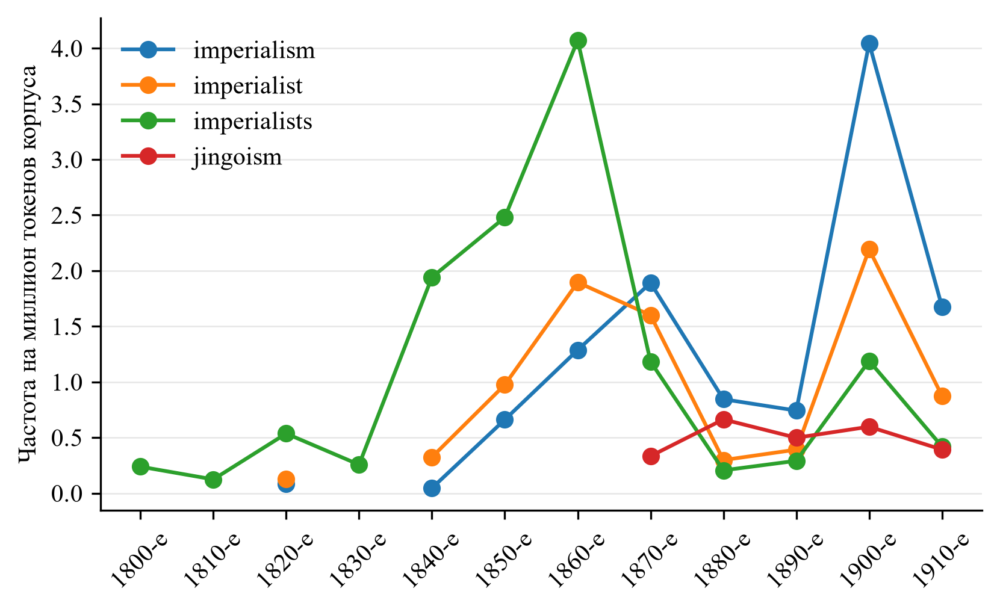
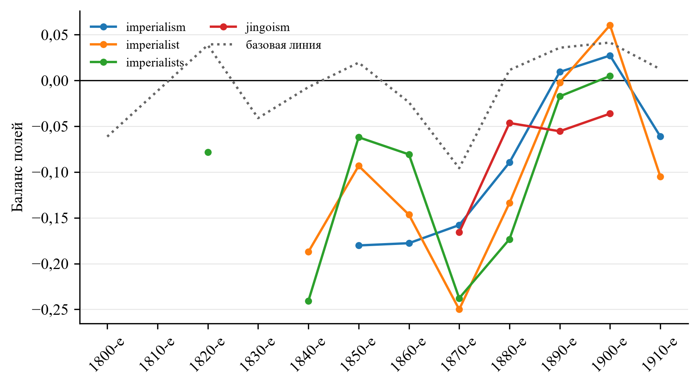
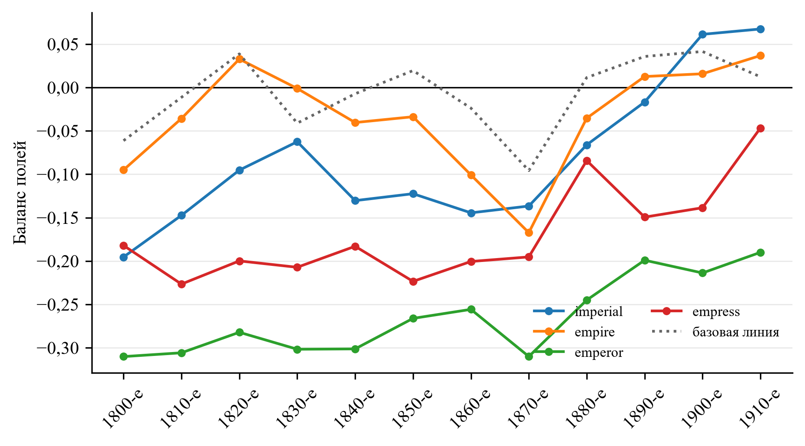

# Империя и империализм в британской прессе 1800–1919 гг.: опыт диахронического векторного анализа

**Аннотация.** В статье исследуется динамика имперской лексики британской прессы 1800–1919 гг. на материале двенадцати десятилетних векторных моделей проекта *Living with Machines*. Сопоставляются частоты словоформ, их ближайшие соседи после исключения искажённых при распознавании записей и относительная близость к двум наборам слов, связанным с Британией и иностранными державами. В середине XIX века окружение *imperialists* указывает на венгерские, китайские и мексиканские события, в которых слово обозначало сторонников императорской власти, тогда как *imperialism* сближается с лексикой бонапартизма и монархических режимов. Максимумы частот этих словоформ приходятся соответственно на 1860-е и 1900-е годы. Выраженное преобладание иностранных связей у *imperialism* в 1850–1870-е годы исчезает к 1890-м: на рубеже веков слово перестаёт отличаться по этому показателю от обычной государственной лексики, а в 1910-е годы, на фоне германской и военной тематики, вновь сближается с иностранным набором. Слово *empire* подобного направленного изменения не обнаруживает, у *imperial* результат зависит от состава опорных слов, у *emperor* и *empress* близость к иностранному набору преобладает на всём протяжении периода. Окружение *empire* и *imperial* в начале XX века в значительной мере образовано лексикой зрелищ и торговли. Сопоставление результатов с историографией показывает, что история политического понятия империализма не совпадает с историей имперской лексики и что изменения отдельных слов не сводятся к единому процессу освоения имперской терминологии британским политическим языком.

**Ключевые слова:** Британская империя, империализм, британская пресса, политический язык, историческая семантика, диахронические векторные модели, джингоизм.

## Введение

К середине XIX века Великобритания уже обладала обширными колониальными владениями, однако слово *imperialism* в британском политическом языке относилось преимущественно к Франции. Лишь в последней трети столетия оно стало широко употребляться при обсуждении политики самой Великобритании, тогда как *empire* задолго до этого применялось к британским владениям [Koebner R., Schmidt H. D. Imperialism: The Story and Significance of a Political Word, 1840–1960. Cambridge: Cambridge University Press, 1964. P. 1–10, 27–34, 117–123, 147–157]. Возникает вопрос: сопровождалось ли изменение употребления *imperialism* аналогичными изменениями других слов, связанных с империей и императорской властью?

Для изучения этой проблемы особенно важна периодическая печать. Наряду с обсуждением британской имперской политики газеты содержали сообщения о зарубежных событиях, коммерческие объявления и материалы о культурной жизни. Исследование газетного языка позволяет поэтому выйти за пределы истории политических идей и программ.

Диахронические векторные модели позволяют изучать изменения отношений между словами на материале больших массивов исторических текстов [Wevers M., Koolen M. Digital Begriffsgeschichte: Tracing Semantic Change Using Word Embeddings // Historical Methods. 2020. Vol. 53, no. 4. P. 226–243. DOI: 10.1080/01615440.2020.1760157]. Н. Педраццини и Б. Макгилливрей продемонстрировали возможности такого подхода на примере лексики механизации в британских газетах XIX века [Pedrazzini N., McGillivray B. Machines in the Media: Semantic Change in the Lexicon of Mechanization in 19th-Century British Newspapers // Proceedings of the 2nd International Workshop on Natural Language Processing for Digital Humanities. Taipei: Association for Computational Linguistics, 2022. P. 85–95. DOI: 10.18653/v1/2022.nlp4dh-1.12].

Цель настоящей работы — выявить особенности исторической динамики имперской лексики британской прессы 1800–1919 гг. Материалом служат двенадцать десятилетних векторных моделей проекта *Living with Machines*. Сопоставление частот, ближайших соседей и относительной близости исследуемых слов к британским и иностранным обозначениям позволяет рассмотреть историю политического понятия империализма в контексте изменений более широкой лексики.

## 1. Историография

Основополагающей работой по истории имперской терминологии остаётся монография Р. Кёбнера и Х. Д. Шмидта. Авторы показали, что *imperialist* имело иную историю, чем *imperialism*. Первое слово употреблялось для обозначения сторонников императоров Священной Римской империи, а после её упразднения могло применяться к сторонникам императорской власти в других странах. Так, в статье о Франции, опубликованной в *North British Review* в мае 1851 г., сторонников Луи Наполеона называли *imperialists* и *bonapartists*, тогда как *imperialism* характеризовало французский политический порядок, в котором представительные институты сочетались с централизованной бюрократической властью. В британской публицистике 1850–1860-х годов этот термин связывался прежде всего с режимом Наполеона III и воспринимался в свете представлений о несовместимости бонапартистской системы с британскими конституционными традициями [Koebner R., Schmidt H. D. Imperialism… P. 7–10].

Вопрос о сохранении британских колониальных владений долгое время обсуждался независимо от этой политической терминологии, как показывает, например, книга Голдвина Смита *The Empire* (1863). В 1868 г. журнал *The Spectator* попытался придать слову *imperialism* положительный смысл применительно к британским обязательствам в мире, но такая трактовка не получила тогда широкого распространения [Koebner R., Schmidt H. D. Imperialism… P. 24–34].

Важным этапом включения *imperialism* в британскую политическую полемику стали дебаты о законопроекте о королевских титулах в 1876 г., позволившем Виктории принять титул императрицы Индии. Противники законопроекта, в том числе Р. Лоу, обращались к историческим ассоциациям слова *emperor* с властью, не ограниченной законом. Сторонники нового титула, напротив, ссылались на то, что Великобритания уже являлась империей, а применение титула могло быть ограничено Индией. Слова *imperialism* и *imperialist* использовались в этой полемике для характеристики политики Дизраэли через аналогии с континентальными политическими порядками. Впоследствии *imperialism* стало одним из обозначений, с помощью которых оппозиция критиковала внешнюю политику консервативного правительства [Koebner R., Schmidt H. D. Imperialism… P. 117–123, 147–157].

Связь имперской терминологии с партийной борьбой особенно отчётливо проявилась во время Восточного кризиса 1876–1878 гг. Р. Шеннон исследовал роль Гладстона, либеральной прессы и общественных организаций в кампании против политики Османской империи после подавления болгарского восстания [Shannon R. T. Gladstone and the Bulgarian Agitation 1876. 2nd ed. Hassocks: Harvester Press, 1975. P. 43–45, 234–235]. В спорах о возможной войне с Россией возникли обозначения *jingo* и *jingoism*. К. В. Душенко показал, что противники джингоизма связывали воинственный патриотизм с угрозой конституционным свободам [Душенко К. В. «Русофобия» в ряду прочих фобий и маний: из истории политического языка. М.: ИНИОН РАН, 2024. С. 160–169]. Э. Кинг на материале оцифрованной прессы проследил появление политических обозначений *jingo* в марте и *jingoism* в апреле 1878 г. К 1880 г. эти слова использовались преимущественно в либеральной печати для критики консервативной внешней политики [King E. The Emergence of “Jingo” and “Jingoism” as Political Terms in Public Debate in Great Britain (1878–1880) // Journal of Historical Pragmatics. 2014. Vol. 15, no. 2. P. 292–313, здесь P. 303, 308. DOI: 10.1075/jhp.15.2.07kin]. Н. В. Дронова рассмотрела обозначение «джинго» как средство политической дискредитации противников либералов в журнале *Punch* [Дронова Н. В. К вопросу о политических технологиях викторианской Англии: концепт «джинго» в издательской практике журнала “Punch” (1878–1879) // Вестник Тамбовского университета. Серия: Гуманитарные науки. 2021. Т. 26, № 190. С. 223–234, здесь С. 232–233. DOI: 10.20310/1810-0201-2021-26-190-223-234].

Согласно Кёбнеру и Шмидту, после выборов 1880 г. *imperialism* утратило прежнюю роль лозунга оппозиции, а с середины 1880-х годов всё чаще употреблялось в положительном смысле. В 1890-е годы приверженность империализму могла служить основанием для политического самоопределения. Англо-бурская война 1899–1902 гг. вновь усилила критическое употребление термина, а в начале XX века он приобрёл более широкое международное значение [Koebner R., Schmidt H. D. Imperialism… P. 166, 173, 195, 219–225, 248–250].

Э. С. Томпсон на материале деятельности британских внепарламентских политических организаций в 1895–1914 гг. показал, что борьба за содержание понятий *empire* и *imperialism* велась как между партиями, так и внутри них. Консервативные организации подчёркивали необходимость сохранения британского могущества и укрепления связей с переселенческими колониями. Бернард Шоу и часть фабианцев стремились соединить имперскую политику с программой социальных реформ, а радикальные либералы критиковали агрессивную экспансию и её экономические последствия, сохраняя неоднозначное отношение к существованию империи. После Англо-бурской войны консерваторы удержали ведущую роль в формировании языка империализма, но их положение было менее прочным, чем в 1890-е годы [Thompson A. S. The Language of Imperialism and the Meanings of Empire: Imperial Discourse in British Politics, 1895–1914 // Journal of British Studies. 1997. Vol. 36, no. 2. P. 147–177, здесь P. 147–151, 156–160, 162–167, 176–177. DOI: 10.1086/386132].

История имперской мысли не ограничивается дискуссиями о значении *imperialism*. Дж. Питтс проследила поворот от критики европейской экспансии в политической мысли конца XVIII века к обоснованию имперского господства рядом британских и французских либералов первой половины XIX века [Pitts J. A Turn to Empire: The Rise of Imperial Liberalism in Britain and France. Princeton; Oxford: Princeton University Press, 2005. P. 1–5, 138–149]. В. В. Грудзинский исследовал преобразование отношений метрополии с переселенческими колониями, британского управления Индией и становление неформальной империи под влиянием либеральной идеологии [Грудзинский В. В. Великобритания и ее империя в середине XIX века: либерализм и проблема модернизации. Челябинск: Энциклопедия, 2015. С. 5–6, 194–196]. Д. Белл рассмотрел многообразие проектов *Greater Britain* в 1860–1890-е годы, в том числе представления об имперском единстве и федерации [Bell D. The Idea of Greater Britain: Empire and the Future of World Order, 1860–1900. Princeton; Oxford: Princeton University Press, 2007. P. 12–15, 217–221, 235–238]. Эти работы раскрывают содержание британских имперских дискуссий, которые не сводились к обсуждению империализма как политической программы.

Другой круг исследований посвящён месту империи в британской культуре. Дж. М. Маккензи связывал становление нового типа патриотизма в последней трети XIX века с распространением представлений о могуществе монархии, военной силе и особой миссии Британии. Наряду с деятельностью пропагандистских организаций он исследовал использование имперской символики в коммерческой рекламе, театре, мюзик-холле и кино [MacKenzie J. M. Propaganda and Empire: The Manipulation of British Public Opinion, 1880–1960. Manchester: Manchester University Press, 1984. P. 1–4, 15–17, 39–95].

Б. Портер, полемизируя с представлением о всеобъемлющем влиянии империи на британское общество, подчёркивал необходимость соотносить её значение с другими факторами общественной и культурной жизни. Он предостерегал от отождествления патриотизма с империализмом и от выводов о взглядах различных социальных групп на основании одного лишь распространения имперской пропаганды [Porter B. The Absent-Minded Imperialists: Empire, Society, and Culture in Britain. Oxford: Oxford University Press, 2004. P. vii–x, 12–15, 114–115]. К. Холл и С. Роуз предложили исследовать, каким образом существование империи формировало повседневные практики жителей метрополии независимо от их политических убеждений. Империя могла восприниматься как привычная составляющая окружающего мира, но её влияние было неодинаковым, а в моменты кризисов имперские вопросы становились предметом открытых дискуссий [Hall C., Rose S. O. Introduction: Being at Home with the Empire // At Home with the Empire: Metropolitan Culture and the Imperial World / ed. by C. Hall, S. O. Rose. Cambridge: Cambridge University Press, 2006. P. 1–31, здесь P. 2–3, 16–17, 21–23].

Из рассмотренной литературы вытекают три исследовательских вопроса. Во-первых, насколько совпадала динамика *imperialism*, *imperialist* и *imperialists* и какое место в ней занимало сближение с *jingoism*? Во-вторых, сопровождалось ли включение политической терминологии империализма в британскую полемику аналогичными изменениями связей *empire*, *imperial*, *emperor* и *empress* с британскими и иностранными обозначениями? В-третьих, какие сферы употребления имперских слов, помимо политических дискуссий, выявляются на материале газет?

## 2. Материалы и методы

### 2.1. Источниковая база

Использованы двенадцать десятилетних векторных моделей, опубликованных Н. Педраццини в 2023 г. и обученных на автоматически распознанных текстах газет, оцифрованных Британской библиотекой [Pedrazzini N. Decade-level Word2Vec models from automatically transcribed 19th-century newspapers digitised by the British Library (1800–1919). Version 1. Zenodo, 2023. DOI: 10.5281/zenodo.7887305]. Каждая модель представляет один десятилетний срез газетного материала, от 1800–1809 до 1910–1919 гг. Исследование проводится на готовых моделях, а не на самих газетных текстах.

Методологическим ориентиром служит работа Педраццини и Макгилливрей о лексике механизации. Авторы сопоставляли векторы слов в выровненных моделях разных десятилетий, определяли возможные моменты семантических изменений и интерпретировали ближайших соседей с привлечением историко-лингвистической литературы и Оксфордского словаря английского языка [Pedrazzini N., McGillivray B. Machines in the Media… P. 86–89]. В настоящей работе используется их подход к исторической интерпретации соседей, но не процедура автоматического обнаружения семантических изменений.

Выбор набора 2023 г. обусловлен полнотой словарей и наличием сведений о частотах. В ранее опубликованном наборе выровненных моделей словари за 1830–1909 гг. ограничены примерно 48 тыс. записей на десятилетие [Pedrazzini N., McGillivray B. Diachronic word embeddings from 19th-century newspapers digitised by the British Library (1800–1919). Zenodo, 2022. DOI: 10.5281/zenodo.7181682]. В отдельных десятилетиях в них отсутствуют *imperialism*, *imperialist* и *jingoism*. Словари моделей 2023 г. содержат от 137 888 до 428 930 записей, включая искажения, возникшие при распознавании текста. Эти модели не выровнены, однако для сопоставления сходств между словами внутри отдельных десятилетий выравнивание не требуется.

Все двенадцать моделей обучены по архитектуре *skip-gram* (Word2Vec). По данным опубликованных файлов, размерность векторов составляет 200, максимальный размер контекстного окна — пять слов с каждой стороны, минимальная частота включения словоформы в словарь — десять употреблений, число эпох обучения и отрицательных примеров — по пять. Суммарное значение параметра `corpus_total_words`, отражающего число токенов, учтённых при формировании словарей, составляет 2 683 235 472. В описании набора на Zenodo указаны другие значения размерности (100), минимальной частоты (5) и объёма корпуса (4,2 млрд слов). В работе используются фактические параметры файлов, а зарегистрированное в них число токенов не отождествляется с объёмом исходной газетной коллекции.

### 2.2. Частоты и контекстное окружение исследуемых слов

Выборка включает политическую терминологию империализма (*imperialism, imperialist, imperialists*), более раннюю лексику империи (*empire, imperial*) и обозначения императорского титула (*emperor, empress*). В неё включено также *jingoism* в связи с историей политической полемики последней трети XIX века. Этот набор не является исчерпывающим перечнем имперской лексики.

Единицей анализа является словоформа, представленная в словаре модели. Формы *imperialist* и *imperialists* рассматриваются раздельно, поскольку могут различаться по характеру употребления [Pedrazzini N., McGillivray B. Machines in the Media… P. 87, note 8]. Модели не разграничивают части речи, поэтому вектор *imperialist* может отражать контексты как существительного, так и прилагательного.

Частоты определялись по числу зарегистрированных употреблений словоформы, сохранённому в файле модели (`count`), и пересчитывались на миллион токенов соответствующего десятилетия с использованием параметра `corpus_total_words`. Отсутствие словоформы в словаре обозначалось пропуском, поскольку оно не означает отсутствия соответствующего слова в газетных текстах.

Векторные модели основаны на принципе дистрибутивной семантики, согласно которому о значении слова можно судить по характеру его контекстов [Lenci A., Sahlgren M. Distributional Semantics. Cambridge: Cambridge University Press, 2023]. Каждой словарной записи соответствует вектор, отражающий закономерности её употребления. Близость слов определяется по косинусу угла между векторами. Соседями могут быть не только синонимы, но и обозначения участников одного события, в том числе противоборствующих сторон, или слова, относящиеся к одной сфере общественной жизни. Списки соседей сопоставлялись по десятилетиям для выявления тематических связей, интерпретируемых с опорой на историческую литературу.

Надёжность оценок сходства зависит от частоты слова и состава обучающих текстов [Antoniak M., Mimno D. Evaluating the Stability of Embedding-based Word Similarities // Transactions of the Association for Computational Linguistics. 2018. Vol. 6. P. 107–119. DOI: 10.1162/tacl_a_00008]. Для ограничения анализа редких записей принят рабочий порог в 50 зарегистрированных употреблений словоформы за десятилетие. Он не является установленной границей устойчивости вектора. При меньшей частоте учитывались только частотные данные.

### 2.3. Фильтрация ближайших соседей

Ошибочные написания могут оказаться близкими соседями правильно распознанного слова [van Strien D., Beelen K., Coll Ardanuy M., Hosseini K., McGillivray B., Colavizza G. Assessing the Impact of OCR Quality on Downstream NLP Tasks // Proceedings of the 12th International Conference on Agents and Artificial Intelligence. Vol. 1: ARTIDIGH. SciTePress, 2020. P. 484–496. DOI: 10.5220/0009169004840496]. Так, среди соседей *empire* встречаются *enipire, empiro, mpire*. По примеру Педраццини и Макгилливрей явно искажённые написания исключались из интерпретируемых списков [Pedrazzini N., McGillivray B. Machines in the Media… P. 94–95].

Для каждой исследуемой словоформы в каждой модели, где она присутствует, извлекались 500 ближайших соседей в порядке убывания косинусного сходства. Орфографический словарь *pyspellchecker* использовался для выявления нестандартных написаний, но отсутствие формы в нём само по себе не служило основанием для исключения. Из списков удалялись идентифицированные искажения (*imperia, empres, rassia, aggresive, rigime*), слитные и усечённые записи (*theimportation, tionist*), числовые и другие нелексические токены. Содержательно интерпретируемые имена собственные, исторические и иноязычные написания сохранялись. Экспертные решения и правила исключения фиксировались отдельно от исходных списков. Для анализа отбирались первые тридцать соседей после фильтрации. Решения принимались по облику записей и их окружению без обращения к газетным оригиналам, поэтому могли сохраняться неоднозначные формы. Исходные векторы и частоты не изменялись.

Для получения тридцати сохранённых соседей по 75 парам «словоформа — десятилетие», удовлетворяющим частотному порогу, было просмотрено 4 788 позиций, из которых исключено 2 538 (53%). В 23 случаях исключено не менее половины просмотренных записей. Особенно велико число исключений у *imperial*: в модели 1900-х годов тридцатый сохранённый сосед занимает 244-ю позицию исходного списка. Эти данные характеризуют фильтрацию списков, а не долю ошибок распознавания во всём корпусе. При большом числе исключений в отобранный список попадают менее близкие соседи, поэтому окружение *imperial* используется преимущественно как вспомогательный материал.

### 2.4. Относительная близость к британскому и иностранному полям

Для сопоставления связей имперской лексики с британскими и иностранными обозначениями рассчитывалась разность средних косинусных сходств слова с двумя опорными наборами. Такой принцип применяется, в частности, при изучении культурных ассоциаций на основе векторных моделей [Caliskan A., Bryson J. J., Narayanan A. Semantics Derived Automatically from Language Corpora Contain Human-like Biases // Science. 2017. Vol. 356, no. 6334. P. 183–186. DOI: 10.1126/science.aal4230]. В отличие от указанной работы, здесь используется только разность средних, без статистической процедуры. Показатель, далее именуемый балансом семантических полей, определялся по формуле:

$$
B_t(w)=\frac{1}{|A|}\sum_{a\in A}\cos_t(w,a)-\frac{1}{|F|}\sum_{f\in F}\cos_t(w,f),
$$

где $w$ — исследуемая словоформа, $t$ — десятилетие, $A$ и $F$ — британский и иностранный опорные наборы, а $\cos_t$ — косинусное сходство векторов двух слов в модели данного десятилетия. Все слова внутри каждого набора имеют одинаковый вес. Положительное значение баланса означает большее среднее сходство с британским набором, отрицательное — с иностранным. Значение, близкое к нулю, указывает на небольшую разность этих сходств, но не обязательно на тесную связь с обоими наборами.

Использовались два варианта состава полей:

| Вариант | Британское поле ($A$) | Иностранное поле ($F$) |
| --- | --- | --- |
| Основной | *british, britain, colonies, colonial, india, canada, dominion, queen* | *france, french, napoleon, bonaparte, austria, austrian, russia, russian, turkey, ottoman, germany, german* |
| Альтернативный | *britain, british, england, english* | *france, french, austria, austrian, russia, russian, turkey, turkish, germany, german* |

Основной британский набор включает колониальную и монархическую лексику, иностранный — обозначения избранных держав и слова, связанные с наполеоновской тематикой. Некоторые опорные слова, прежде всего *colonial* и *colonies*, применимы и к другим державам, а включение *napoleon* и *bonaparte* усиливает представительство Франции. Иностранный набор не охватывает всех зарубежных государств, в частности Китая и Мексики. Альтернативный вариант ограничен названиями стран и национальными обозначениями. Сопоставление вариантов позволяет оценить зависимость баланса от состава полей, но не выделить вклад отдельных опорных слов. Состав каждого набора оставался постоянным во всех десятилетиях.

В качестве ориентира использовалась базовая линия — средний баланс пяти слов государственной лексики (*kingdom, government, army, nation, crown*) в каждом десятилетии. Она рассчитывалась отдельно для обоих вариантов полей и позволяла сопоставить изменения у имперских слов с динамикой выбранной государственной лексики.

При замене основного состава полей альтернативным средняя величина абсолютного изменения баланса составляет около 0,04, максимальная — 0,11. Значение 0,04 используется как условный ориентир: меньшие или равные ему по модулю значения баланса рассматриваются как близкие к нулю, а их знак сам по себе не интерпретируется. Это описательное правило, а не критерий статистической значимости. При интерпретации учитываются результаты обоих вариантов, базовая линия и ближайшие соседи. Рост баланса может отражать как увеличение сходства с британским набором, так и уменьшение сходства с иностранным. Баланс не измеряет долю употреблений слова применительно к той или иной стране.

### 2.5. Ограничения исследования и воспроизводимость

Оцифрованные газетные коллекции неодинаково представляют регионы, типы изданий и политические направления печати [Beelen K., Lawrence J., Wilson D. C. S., Beavan D. Bias and Representativeness in Digitized Newspaper Collections: Introducing the Environmental Scan // Digital Scholarship in the Humanities. 2023. Vol. 38, no. 1. P. 1–22. DOI: 10.1093/llc/fqac037]. Нормирование частот учитывает различия в объёме десятилетних подкорпусов, но не в их составе. Ошибки распознавания влияют на частоты и векторы слов. Кроме того, статическая модель объединяет различные употребления словоформы в одном векторе, а десятилетняя группировка не позволяет установить влияние отдельного события. Поэтому выявленные изменения могут отражать как динамику словоупотребления, так и особенности состава газетной коллекции. Исследование не предполагает самостоятельной реконструкции отдельных газетных контекстов или количественной оценки распространённости значений слов и политических убеждений читателей.

Программный код, исходные и отфильтрованные списки соседей, правила фильтрации и сохранённые экспертные решения, таблицы частот и показатели сходства опубликованы в репозитории проекта (https://github.com/alexeyvkuznetsov/british-press-semantic-change, состояние на 13 ноября 2026 г., коммит 1ec110e). Подготовка данных осуществляется в ноутбуке `00_prepare_data.ipynb`, анализ имперской лексики — в `01_imperial_lexicon.ipynb`.

## 3. Результаты

Все таблицы и рисунки данного раздела составлены по результатам расчётов автора на основе моделей *Living with Machines* 2023 г.

### 3.1. Частоты и контекстное окружение политической терминологии империализма

Сопоставление нормированных частот *imperialism*, *imperialist* и *imperialists* показывает, что эти словоформы распространялись неодновременно (рис. 1). *Imperialists* присутствует в словарях всех двенадцати моделей, тогда как *imperialism* и *imperialist* регулярно представлены начиная с 1840-х годов. В модели 1820-х годов зарегистрировано лишь 11 употреблений *imperialism* и 17 употреблений *imperialist*, в модели 1840-х — 15 употреблений *imperialism*. Эти записи не достигают частотного порога и могут включать ошибки распознавания, поэтому не позволяют датировать появление слов.

В 1850–1870-е годы частота *imperialism* возрастает с 0,66 до 1,89 употребления на миллион токенов. После снижения в 1880–1890-е годы она достигает максимума в 1900-е годы (4,04). У *imperialist* максимум также приходится на 1900-е годы (2,19), но уже в 1860-е частота составляет 1,89. Иная динамика у *imperialists*: максимум наблюдается в 1860-е годы (4,07), после чего частота уменьшается и к 1880-м составляет 0,21. Таким образом, максимум частоты множественного числа предшествует максимумам двух других словоформ на четыре десятилетия.

*Рис. 1. Частоты слов imperialism, imperialist, imperialists и jingoism в британской прессе по десятилетиям (на миллион токенов). Пропуски соответствуют отсутствию словоформы в словаре модели.*

Состав ближайших соседей *imperialists* позволяет выделить несколько исторических контекстов, существенных для интерпретации высокой частоты этой словоформы в середине XIX века (табл. 1). В модели 1840-х годов названия городов Комарома (*comorn*), Ваца (*waitzen*), Сибиу (*hermannstadt*) и Сегеда (*szegedin*), а также обозначения участников событий (*magyars, austrians, hungarians*) и имена военачальников (*paskiewich, jellachich, windischgratz*) отсылают к Венгерской революции 1848–1849 гг. В 1850-е годы среди соседей выделяются названия китайских городов (*chinkeang, chingkiang, nanking*) и обозначения повстанцев (*insurgents, rebels*). В 1860-е годы наряду с обозначениями тайпинов (*taepings, taipings*) появляются имена участников борьбы против империи Максимилиана в Мексике (*juarez, porfirio, escobedo* — Б. Хуарес, П. Диас, М. Эскобедо).

Сходные связи обнаруживаются и у *imperialist*. Первым его соседом после фильтрации в 1840-е годы является *paskiewich*, а в 1860-е среди ближайших находятся *porfirio, escobedo, queretaro, juarez*. Эти группы согласуются с употреблением *imperialist* в значении сторонника императора, описанным Кёбнером и Шмидтом (см. раздел 1), и позволяют связать обе словоформы с сообщениями о противостоянии сторонников и противников австрийской, цинской и мексиканской императорской власти. Некоторые соседи допускают и другие интерпретации: *mutineers* в модели 1850-х годов может указывать также на Индийское восстание 1857 г.

**Таблица 1. Избранные ближайшие соседи словоформы *imperialists***

| Десятилетие | Соседи |
| --- | --- |
| 1840-е | magyars, austrians, hungarians, comorn, waitzen, insurgents, hermannstadt, szegedin, szeklers |
| 1850-е | insurgents, rebels, imperialist, chinkeang, chingkiang, mutineers, nanking |
| 1860-е | rebels, taepings, imperialist, juarez, cortinas, juarists, porfirio, taipings, escobedo |
| 1870-е | orleanists, legitimists, bonapartists, republicans, bonapartism, bonapartist, gambetta, fusionist |
| 1880-е | orleanists, ultramontanes, monarchists, bonapartism, legitimists, reactionaries, opportunists, jeromists |
| 1890-е | monarchists, monarchist, constitutionalists, progressists, hovas, africanders, afrikanders, dreyfusards |
| 1900-е | imperialist, proboers, labourists, politicians, englanders, radicals, protectionism, tories |

*Примечание. В табл. 1–2 приведены избранные слова из первых тридцати соседей после фильтрации для иллюстрации обсуждаемых контекстов. Порядок следования по косинусному сходству сохранён. Представлены избранные десятилетия с частотой не ниже принятого порога. Полные списки опубликованы в репозитории.*

В 1870-е годы окружение *imperialists* отсылает к борьбе французских политических течений после падения Второй империи: наряду со словами *orleanists, legitimists, bonapartists, republicans* выделяются *gambetta, rouher, frohsdorf*. В 1880-е годы, несмотря на малое число зарегистрированных употреблений (69), французская политическая тематика сохраняется. В 1890-е годы (87 употреблений) к обозначениям политических течений добавляются слова, отсылающие к африканским событиям (*hovas, africanders, afrikanders*).

В 1900-е годы заметное место среди соседей *imperialists* занимает лексика британской политической борьбы (*proboers, labourists, radicals, tories, protectionism*). Формы *englanders* и *englander*, вероятно, связаны с обозначением *Little Englanders*, употреблявшимся по отношению к противникам имперской экспансии. Тематическое окружение этого десятилетия позволяет соотнести слово с полемикой вокруг Англо-бурской войны, партийной борьбой и спорами об экономической политике. В отличие от середины века, когда ближайшие соседи указывают на различные зарубежные конфликты, здесь отчётливо представлены вопросы политики самой Великобритании.

У *imperialism* характер окружения иной (табл. 2). В 1850-е годы выделяются обозначения французских политических течений и монархических порядков (*jacobinism, bonapartism, monarchic, orleanism, napoleonism*), в 1860-е наряду с ними — *democracy, republicanism, despotism*. В 1870-е годы первым соседом становится *jingoism*, а в первой десятке появляется *toryism*.

**Таблица 2. Избранные ближайшие соседи слова *imperialism***

| Десятилетие | Соседи |
| --- | --- |
| 1850-е | jacobinism, bonapartism, monarchic, monarchical, monarchists, orleanism, napoleonism, republicanism |
| 1860-е | chauvinism, democracy, napoleonism, monarchical, theocratic, bonapartism, republicanism, despotism |
| 1870-е | jingoism, imperialistic, monarchy, despotism, toryism, bonapartism, republicanism, militarism |
| 1880-е | absolutism, despotism, ecclesiasticism, jingoism, chauvinism, protectionism, whiggery, aggrandizement |
| 1890-е | priestcraft, philippic, catchword, imbroglio, cavour, protectionist, tyrannic, jingoism, tyranny |
| 1900-е | socialism, jingoism, internationalism, patriotism, constitutionalism, democracy, imperialist, zollverein, proboer |
| 1910-е | constitutionalism, imperialist, democracy, hegemony, imperialists, militarist, jingoes, kaiserism, prussianism, insularity |

В 1880-е годы среди соседей *imperialism* сохраняются обозначения политических порядков и течений, но прямые указания на конкретные страны и деятелей встречаются реже. Окружение 1890-х годов труднее интерпретировать: наряду с политической лексикой (*protectionist, jingoism, tyranny*) в первые тридцать соседей входят имена и редкие слова, не образующие очевидной тематической группы (*sennacherib, blastus, bombastes*). При сравнительно небольшой частоте *imperialism* в этом десятилетии (222 употребления) состав соседей не даёт достаточных оснований для определённой исторической интерпретации.

В 1900-е годы, когда частота *imperialism* достигает максимума, среди ближайших соседей заметное место занимают обозначения идеологий и принципов общественного устройства (*socialism, internationalism, patriotism, constitutionalism, democracy*). В том же окружении присутствует лексика конкретных британских споров начала века (*zollverein, proboer, englandism, conscriptionist*). В 1910-е годы выделяются обозначения германской и военно-политической тематики (*kaiserism, prussianism, germanism, treitschke, hegemony, militarist, militarism*). Одновременно сохраняются связи с обозначениями идеологий (*internationalism, nationalism, collectivism, capitalism*) и словами британской политической полемики (*jingoes, insularity*).

### 3.2. Изменение соотношения британских и иностранных связей политической лексики

Сопоставление баланса опорных полей позволяет проследить, как менялись отношения исследуемых слов к британским и иностранным обозначениям (рис. 2). В 1850–1870-е годы у *imperialism* сохраняется выраженный отрицательный баланс: при основном составе полей его значения составляют от −0,180 до −0,158. В 1880-е годы отрицательная разность уменьшается (−0,090), а в 1890-е и 1900-е годы баланс близок к нулю (+0,009 и +0,027). При альтернативном составе приближение к нулю обнаруживается уже в 1880-е годы (−0,004), а в 1900-е годы значение +0,077 указывает на преимущество британского набора. Следовательно, оба варианта показывают уменьшение преобладания связей с иностранными обозначениями к концу XIX века, хотя различаются в оценке их соотношения на рубеже веков.

*Рис. 2. Баланс британского и иностранного полей (основной вариант) для политической лексики империализма. Пунктирная линия — средний баланс пяти слов государственной лексики. Положительные значения соответствуют большей близости к британскому полю, отрицательные — к иностранному. Точки, для которых частота словоформы в десятилетии ниже 50 употреблений, не показаны.*

В 1870-е годы отрицательный баланс *imperialism* наблюдается на фоне снижения базовой линии (−0,096). Отличие от неё меньше, чем в 1850–1860-е годы. В 1880-е годы базовая линия вновь повышается, и уменьшение отрицательного баланса *imperialism* не сопровождается сближением с ней.

В 1890-е и 1900-е годы средний баланс государственной лексики составляет +0,036 и +0,042 соответственно. Если в 1850-е годы баланс *imperialism* был ниже базовой линии на 0,200 при основном и на 0,126 при альтернативном составе полей, то в 1900-е — лишь на 0,014 и 0,012. Таким образом, в обоих вариантах на рубеже веков соотношение британских и иностранных связей *imperialism* становится близким к соотношению таких связей у выбранной государственной лексики.

У *imperialist* и *imperialists* наиболее выраженные отрицательные значения основного баланса приходятся на 1840-е и 1870-е годы (у *imperialist* −0,187 и −0,250, у *imperialists* −0,241 и −0,238). В 1890-е годы у обеих словоформ основной баланс близок к нулю. В 1900-е годы у *imperialist* обнаруживается преимущество британского набора при обоих составах полей (+0,060 и +0,093), а у *imperialists* баланс составляет +0,005 и +0,041, причём последнее значение лишь немного превышает принятый ориентир (табл. 3).

**Таблица 3. Баланс имперских слов при основном и альтернативном составе полей**

| Словоформа | 1890-е: основной / альтернативный | 1900-е: основной / альтернативный | 1910-е: основной / альтернативный |
| --- | --- | --- | --- |
| imperialism | +0,009 / +0,022 | +0,027 / +0,077 | −0,061 / −0,060 |
| imperialist | −0,002 / +0,052 | +0,060 / +0,093 | −0,105 / −0,088 |
| imperialists | −0,017 / +0,010 | +0,005 / +0,041 | — |
| imperial | −0,017 / −0,050 | +0,061 / −0,005 | +0,067 / +0,021 |
| empire | +0,013 / +0,008 | +0,016 / +0,038 | +0,037 / +0,038 |

*Примечание. Значения, не превышающие по модулю 0,04, рассматриваются как близкие к равновесию. Прочерк означает, что частота словоформы в десятилетии ниже принятого порога.*

В 1910-е годы баланс *imperialism* и *imperialist* вновь становится отрицательным при обоих составах полей (соответственно −0,061 и −0,060, −0,105 и −0,088). Как видно из табл. 2, в окружении *imperialism* при этом выделяется уже не бонапартистская, а германская и военно-политическая тематика.

### 3.3. Империализм и джингоизм

Слово *jingoism* впервые представлено в модели 1870-х годов, где зарегистрировано 87 его употреблений (0,33 на миллион токенов). Поскольку термин появился в британской политической полемике в 1878 г., частота за всё десятилетие не характеризует интенсивность его употребления непосредственно после появления. Максимум частоты приходится на 1880-е годы (0,66), а в 1900-е, когда частота *imperialism* достигает максимума, она составляет 0,60 (рис. 1).

В модели 1870-х годов первые два соседа *jingoism* после фильтрации — *disraelian* и *imperialism* (косинусное сходство 0,763 и 0,718). Шестую позицию занимает *beaconsfieldism*, тринадцатую — *russophobists*. Присутствие таких соседей, как *charlatanry, tergiversation, timeserving, boastings*, согласуется с употреблением этого обозначения противниками воинственного патриотизма [Душенко К. В. «Русофобия» в ряду прочих фобий и маний… С. 162–169].

В 1870-е годы баланс *jingoism* отрицателен при обоих составах полей (−0,166 и −0,096). В 1880–1900-е годы при основном составе он находится в диапазоне от −0,055 до −0,036, а при альтернативном — от −0,012 до +0,025. В отличие от *imperialism*, у *jingoism* в 1900-е годы не обнаруживается выраженного преимущества британского набора ни при одном из вариантов.

### 3.4. Динамика более ранней имперской лексики

Баланс более ранней имперской лексики представлен на рис. 3.

*Рис. 3. Баланс британского и иностранного полей (основной вариант) для imperial, empire, emperor и empress. Пунктирная линия — средний баланс пяти слов государственной лексики. Положительные значения соответствуют большей близости к британскому полю, отрицательные — к иностранному.*

У *empire* при основном составе полей выраженный отрицательный баланс наблюдается в 1800-е годы (−0,095) и в 1860–1870-е годы (−0,101 и −0,167). Минимум приходится на 1870-е годы, когда наиболее низка и базовая линия (−0,096). С 1880-х годов баланс *empire* остаётся близким к нулю (от −0,035 до +0,037), причём в 1890–1910-е годы результаты двух вариантов полей сходны (табл. 3). В отличие от *imperialism*, у этого слова не наблюдается столь длительного преобладания иностранных связей в середине XIX века.

В начале XX века у *empire* особенно заметны изменения ближайшего окружения. В модели 1900-х годов среди соседей находятся имена артистов (*rejane, kreisler, backhaus*), названия театральных постановок (*cingalee, arcadians*), а также *theatre, juggler, palace*. В модели 1910-х годов первое место после фильтрации занимает *cabiria* (название итальянского фильма 1914 г.), среди других соседей присутствуют *photoplays, theatre, cinematography, picturegoers*. Такое окружение позволяет предположить связь словоформы с употреблением *Empire* в названиях зрелищных заведений.

У *imperial* при основном составе полей в XIX веке баланс отрицателен, а в 1900-е и 1910-е годы достигает положительных значений (+0,061 и +0,067). В 1910-е годы показатель выше базовой линии (+0,012). При альтернативном составе в оба десятилетия баланс близок к нулю (−0,005 и +0,021). Следовательно, результат начала XX века зависит от состава полей. Поскольку изменяются оба набора, нельзя однозначно связать положительный баланс с включением колониальной и монархической лексики.

В окружении *imperial* в 1850–1870-е годы выделяются обозначения монархов и государств (*emperor, napoleon, sultan, empress, ottoman, austrian, czar*). В начале XX века оно становится более разнородным. В 1900-е годы наряду с *royal* и *yeomanry* присутствуют *canteens, saleroom, semiporcelain*, в 1910-е — *colonial, exchequer, maritime, buildings*, а также *russian* и *manchu*.

У *emperor* и *empress* баланс отрицателен во всех двенадцати десятилетиях при обоих составах полей. Для *emperor* в 1870-е годы характерны связи с *napoleon, czar, bismarck, thiers, prussia*, в 1910-е — с *archduke, kaiser, abdication, ferdinand, czar*. У *empress* в 1850-е годы выделяются связи с именем императрицы Евгении (*eugenie*), Наполеоном III и французскими императорскими резиденциями. В модели 1870-х годов, охватывающей принятие Викторией титула императрицы Индии (1876 г.) и его провозглашение в Дели 1 января 1877 г., основной баланс *empress* остаётся выраженно отрицательным (−0,195), а первыми соседями являются *eugenie, emperor, napoleon*. В 1910-е годы отрицательная разность сокращается (−0,047 при основном и −0,090 при альтернативном составе).

## 4. Обсуждение

### 4.1. История понятия империализма и история имперской лексики

Сопоставление имперских слов расширяет проблематику, поставленную Кёбнером и Шмидтом. История *imperialists* не сводится к истории бонапартизма и британской имперской политики: в середине XIX века ближайшие соседи слова указывают на освещение газетами конфликтов, в которых противостояли сторонники императорской власти и её противники. Тем самым раздельный анализ словоформ обнаруживает различные области словоупотребления, скрытые за общностью их происхождения. Если бы *imperialist* и *imperialists* рассматривались как одна единица, различие их частотных траекторий оказалось бы менее заметным. Это конкретизирует замечание Педраццини и Макгилливрей о различиях между формами единственного и множественного числа [Pedrazzini N., McGillivray B. Machines in the Media… P. 87, примеч. 8].

Иным аспектом неоднородности имперской лексики является соотношение обозначений империи и императорской власти. Динамика *empire* согласуется с тем, что британские дискуссии о колониальных владениях имели собственную историю, не зависевшую от распространения *imperialism*. Особенно показательно сравнение с *emperor* и *empress*. Как свидетельствуют дебаты 1876 г., признание Великобритании империей не исключало неприятия императорского титула из-за его ассоциаций с неограниченной властью [Koebner R., Schmidt H. D. Imperialism… P. 117–123]. В этом свете сохранение французских связей *empress* в модели 1870-х годов обнаруживает различие между историей императорской титулатуры и изменениями языка британской имперской политики. Вместе с тем десятилетний срез не позволяет установить, как принятие Викторией нового титула повлияло на употребление *empress* применительно к ней.

### 4.2. Империализм в британской политической полемике

Изменения окружения *imperialism* в 1870-е годы помогают понять, почему включение этого термина в британскую полемику не означало вытеснения его иностранных ассоциаций. Как показали Кёбнер и Шмидт, критика политики Дизраэли опиралась именно на аналогию с французским политическим порядком. Применение слова к британским делам опиралось в данном случае на его прежнее содержание. Поэтому появление среди соседей британской партийной лексики при сохраняющемся отрицательном балансе вполне согласуется с историей термина.

Особенно нагляден пример *jingoism*. Оно возникло внутри британского политического языка, но непосредственным предметом полемики были отношения с Россией и положение Османской империи. Его отрицательный баланс в 1870-е годы показывает, что близость к иностранному набору не равнозначна употреблению слова исключительно применительно к зарубежным политическим порядкам. Тесное соседство *jingoism* и *imperialism* отражает пересечение двух линий политического словоупотребления, а различия их последующей динамики свидетельствуют о самостоятельности истории этих обозначений.

Исчезновение выраженного преобладания иностранных связей у *imperialism* к рубежу веков не означает утверждения единственного значения термина. Исследованная Э. С. Томпсоном борьба за содержание понятия между различными политическими течениями позволяет объяснить разнообразие политических и идеологических связей *imperialism* в модели 1900-х годов. Особенно показательно его наблюдение о том, что в 1904 г. либерал О. Биррелл, критикуя империализм, вновь обращался к ассоциациям с иностранным, прежде всего французским, деспотизмом, подобно Р. Лоу в 1870-е годы [Thompson A. S. The Language of Imperialism and the Meanings of Empire… P. 162, note 59]. Прежние ассоциации сохраняли политическую значимость даже тогда, когда термин широко применялся к собственной политике.

Отрицательный баланс *imperialism* в 1910-е годы, в свою очередь, согласуется с описанным Кёбнером и Шмидтом расширением международного значения термина [Koebner R., Schmidt H. D. Imperialism… P. 248–250, 264–270]. Сходные по знаку значения баланса в середине XIX века и в 1910-е годы скрывают различие исторических контекстов: в первом случае окружение связано прежде всего с определённым политическим режимом, во втором — с международным соперничеством. Это различие выявляется при сопоставлении количественного показателя с ближайшими соседями.

### 4.3. Имперские обозначения и повседневная культура

Результаты для *empire* обращают внимание на проблему, существенную для изучения имперской культуры: употребление имперского обозначения не всегда означает, что предметом сообщения является империя. Театральные и кинематографические ассоциации позволяют предположить, что изменения окружения слова в начале XX века связаны, в частности, с употреблением *Empire* в названиях зрелищных заведений. Коммерческая лексика среди соседей *imperial* указывает на сходную проблему, хотя интерпретация окружения этого прилагательного затруднена ошибками распознавания.

Работы Маккензи, Холл и Роуз позволяют рассматривать такие употребления в контексте исследований имперских представлений и повседневности. Однако, как следует из критики Портера, даже доказанное присутствие имперской символики в массовой культуре не позволяет непосредственно судить о её восприятии. Тем более нельзя вывести политические убеждения читателей газет из близости *empire* к названиям постановок или именам артистов. Результаты не решают историографического спора о степени влияния империи на британское общество, но показывают необходимость различать употребление имперской лексики в политическом языке и её присутствие в других сферах газетной коммуникации. Это различие существенно и для интерпретации частот: рост частоты *empire* сам по себе не свидетельствовал бы об усилении внимания печати к империи как политическому явлению.

## Заключение

Исследование диахронических векторных моделей британской прессы 1800–1919 гг. выявило неоднородность исторической динамики имперской лексики. Частотные траектории *imperialism*, *imperialist* и *imperialists* различались, а в окружении последних двух обнаружены связи с зарубежными конфликтами середины XIX века, существенные для истории более раннего употребления этих слов. Сближение *imperialism* с *jingoism* в 1870-е годы не устранило различий в дальнейшей динамике этих терминов.

Включение *imperialism* в британскую политическую полемику сопровождалось сокращением выраженного преобладания иностранных связей к рубежу XIX–XX веков, но не их исчезновением. Динамика *empire* не воспроизводила этой траектории, а обозначения императорского титула сохраняли преимущественную близость к иностранному набору. У *imperial* соотношение связей в начале XX века зависело от состава опорных полей.

Театральное и кинематографическое окружение *empire* и коммерческие связи *imperial* показывают, что изменения контекстных связей слов могут отражать не только преобразование политических понятий, но и изменения сфер словоупотребления. Поэтому сопоставление исторических траекторий нескольких связанных слов позволяет дополнить историю политических понятий исследованием более широкого языка массовых исторических источников.

## Список литературы

### Источники данных

1. Pedrazzini N. Decade-level Word2Vec models from automatically transcribed 19th-century newspapers digitised by the British Library (1800–1919). Version 1. Zenodo, 2023. DOI: 10.5281/zenodo.7887305.
2. Pedrazzini N., McGillivray B. Diachronic word embeddings from 19th-century newspapers digitised by the British Library (1800–1919). Zenodo, 2022. DOI: 10.5281/zenodo.7181682.

### Литература

3. Грудзинский В. В. Великобритания и ее империя в середине XIX века: либерализм и проблема модернизации. Челябинск: Энциклопедия, 2015.
4. Дронова Н. В. К вопросу о политических технологиях викторианской Англии: концепт «джинго» в издательской практике журнала “Punch” (1878–1879) // Вестник Тамбовского университета. Серия: Гуманитарные науки. 2021. Т. 26, № 190. С. 223–234. DOI: 10.20310/1810-0201-2021-26-190-223-234.
5. Душенко К. В. «Русофобия» в ряду прочих фобий и маний: из истории политического языка. М.: ИНИОН РАН, 2024.
6. Antoniak M., Mimno D. Evaluating the Stability of Embedding-based Word Similarities // Transactions of the Association for Computational Linguistics. 2018. Vol. 6. P. 107–119. DOI: 10.1162/tacl_a_00008.
7. Beelen K., Lawrence J., Wilson D. C. S., Beavan D. Bias and Representativeness in Digitized Newspaper Collections: Introducing the Environmental Scan // Digital Scholarship in the Humanities. 2023. Vol. 38, no. 1. P. 1–22. DOI: 10.1093/llc/fqac037.
8. Bell D. The Idea of Greater Britain: Empire and the Future of World Order, 1860–1900. Princeton; Oxford: Princeton University Press, 2007.
9. Caliskan A., Bryson J. J., Narayanan A. Semantics Derived Automatically from Language Corpora Contain Human-like Biases // Science. 2017. Vol. 356, no. 6334. P. 183–186. DOI: 10.1126/science.aal4230.
10. Hall C., Rose S. O. Introduction: Being at Home with the Empire // At Home with the Empire: Metropolitan Culture and the Imperial World / ed. by C. Hall, S. O. Rose. Cambridge: Cambridge University Press, 2006. P. 1–31.
11. King E. The Emergence of “Jingo” and “Jingoism” as Political Terms in Public Debate in Great Britain (1878–1880) // Journal of Historical Pragmatics. 2014. Vol. 15, no. 2. P. 292–313. DOI: 10.1075/jhp.15.2.07kin.
12. Koebner R., Schmidt H. D. Imperialism: The Story and Significance of a Political Word, 1840–1960. Cambridge: Cambridge University Press, 1964.
13. Lenci A., Sahlgren M. Distributional Semantics. Cambridge: Cambridge University Press, 2023.
14. MacKenzie J. M. Propaganda and Empire: The Manipulation of British Public Opinion, 1880–1960. Manchester: Manchester University Press, 1984.
15. Pedrazzini N., McGillivray B. Machines in the Media: Semantic Change in the Lexicon of Mechanization in 19th-Century British Newspapers // Proceedings of the 2nd International Workshop on Natural Language Processing for Digital Humanities. Taipei: Association for Computational Linguistics, 2022. P. 85–95. DOI: 10.18653/v1/2022.nlp4dh-1.12.
16. Pitts J. A Turn to Empire: The Rise of Imperial Liberalism in Britain and France. Princeton; Oxford: Princeton University Press, 2005.
17. Porter B. The Absent-Minded Imperialists: Empire, Society, and Culture in Britain. Oxford: Oxford University Press, 2004.
18. Shannon R. T. Gladstone and the Bulgarian Agitation 1876. 2nd ed. Hassocks: Harvester Press, 1975.
19. Thompson A. S. The Language of Imperialism and the Meanings of Empire: Imperial Discourse in British Politics, 1895–1914 // Journal of British Studies. 1997. Vol. 36, no. 2. P. 147–177.
20. van Strien D., Beelen K., Coll Ardanuy M., Hosseini K., McGillivray B., Colavizza G. Assessing the Impact of OCR Quality on Downstream NLP Tasks // Proceedings of the 12th International Conference on Agents and Artificial Intelligence. Vol. 1: ARTIDIGH. Valletta: SciTePress, 2020. P. 484–496. DOI: 10.5220/0009169004840496.
21. Wevers M., Koolen M. Digital Begriffsgeschichte: Tracing Semantic Change Using Word Embeddings // Historical Methods: A Journal of Quantitative and Interdisciplinary History. 2020. Vol. 53, no. 4. P. 226–243. DOI: 10.1080/01615440.2020.1760157.
